# Projecte 2 · Administració de WordPress amb WP-CLI

Oscar Bravo Villada · IAW · PorçonsTech

Aquest projecte l'he fet en una instància d'AWS amb Ubuntu 24.04, Apache, PHP 8.3 i MariaDB. Com que a `/var/www/html` ja hi havia una altra aplicació PHP (add.php, edit.php, etc.), he instal·lat WordPress en una subcarpeta, `/var/www/html/wordpress`, i totes les ordres `wp` les he executat des d'ahí. La versió de WordPress és la 7.1.4 i la de WP-CLI la 2.12.0.

Les captures estan a la carpeta `imatges/`.

---

## E1 · WP-CLI instal·lat

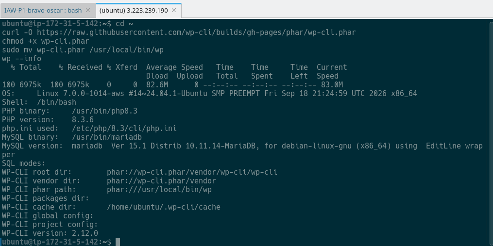

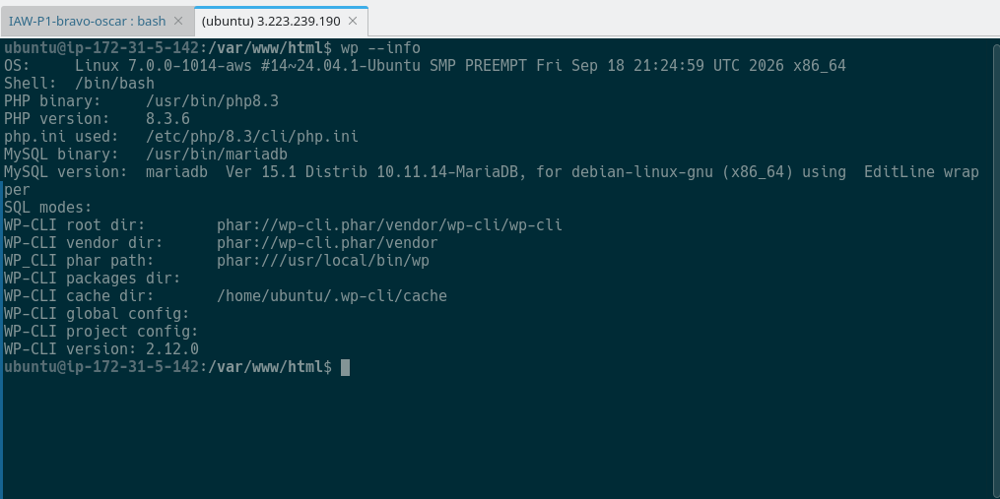

WP-CLI és una eina per a administrar WordPress des del terminal. A la primera captura es veu com el descarrego amb `curl`, li done permisos d'execució i el moc a `/usr/local/bin/wp`. A la segona, `wp --info` mostra que funciona i que detecta PHP 8.3.6 i MariaDB 10.11.

L'avantatge respecte a `wp-admin` és que ho puc fer tot per SSH sense navegador, és més ràpid i les ordres es poden posar en scripts per a automatitzar tasques.

---

## E2 · Plugins

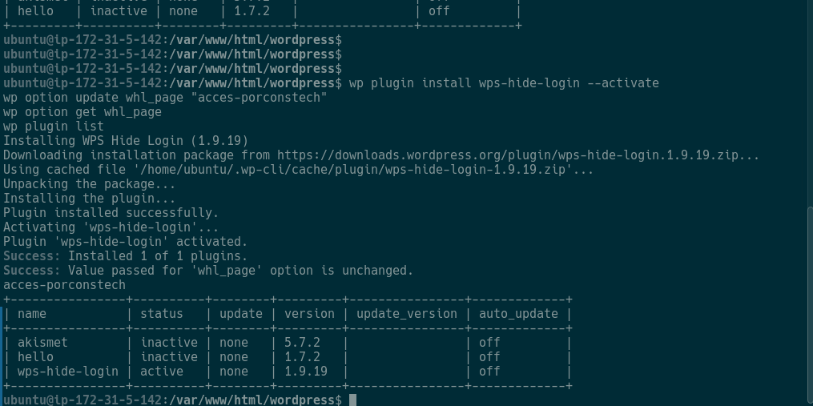

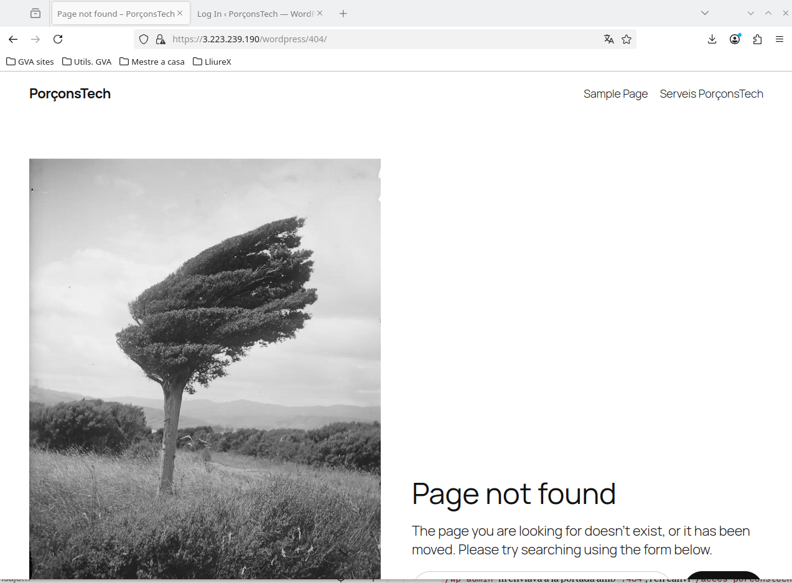

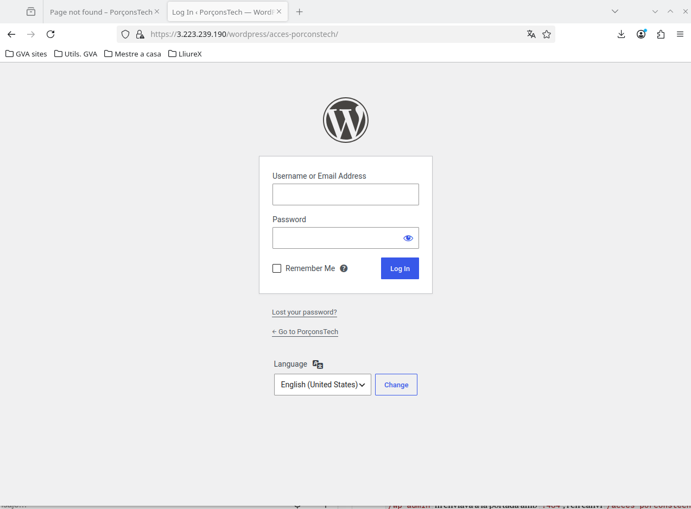

He treballat amb el plugin `wps-hide-login`. A la primera captura es veu com l'instal·lo i l'activo amb `wp plugin install wps-hide-login --activate`, com canvie la ruta d'accés amb `wp option update whl_page "acces-porconstech"` i el `wp plugin list` amb el plugin en estat `active`. El missatge `option is unchanged` ix perquè aquesta opció ja l'havia configurada abans en una prova anterior. Al final també l'he desactivat, activat, actualitzat i eliminat per a veure el cicle complet.

Per a comprovar que de veres funcionava ho he provat al navegador (segona captura): entrant a `/wp-admin` m'enviava a la portada amb `?404`, i en canvi `/acces-porconstech` em mostrava el login.

---

## E3 · Temes

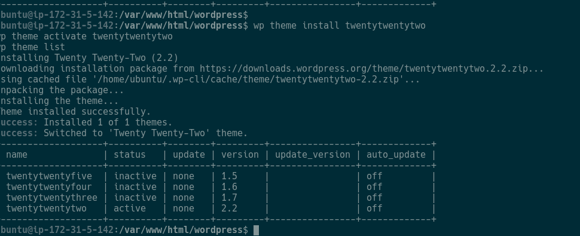

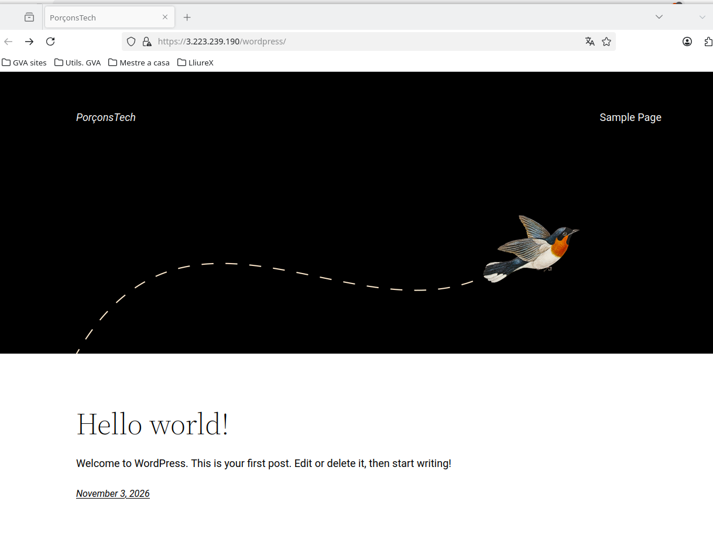

He instal·lat el tema `twentytwentytwo` (versió 2.2) amb `wp theme install` i l'he activat amb `wp theme activate`. A la primera captura es veu el `wp theme list` amb aquest tema com a `active`, i a la segona el portal al navegador amb l'aspecte nou (capçalera negra amb l'ocell). Quan he acabat he tornat a activar el tema original (`twentytwentyfive`) i he esborrat el de prova, i això es veu a la part de dalt de la captura d'E4.

Per a saber quin tema està actiu es fa `wp theme list` i es mira la columna status, on posa `active`.

---

## E4 · Actualitzacions

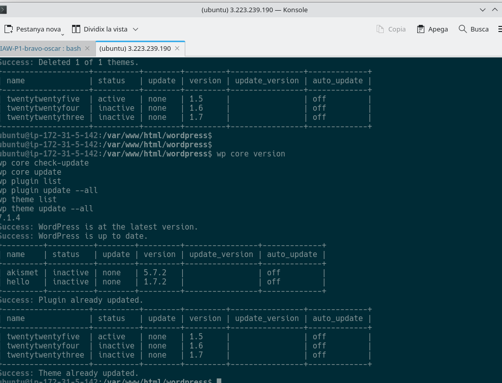

A la captura es veuen `wp core version` (7.1.4), `wp core check-update`, `wp core update`, `wp plugin list`, `wp plugin update --all`, `wp theme list` i `wp theme update --all`. WordPress ja estava a l'última versió i no hi havia res pendent en plugins ni temes, per això els missatges diuen "up to date" i "already updated".

És important actualitzar-ho tot perquè les versions noves arreglen errors i sobretot problemes de seguretat. Un plugin o tema antic és de les maneres més fàcils d'entrar en un WordPress.

---

## E5 · Configuració amb WP-CLI

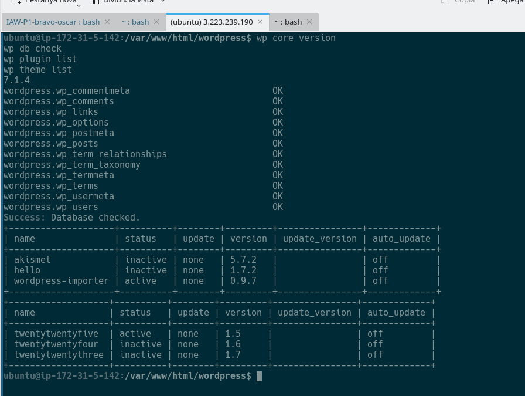

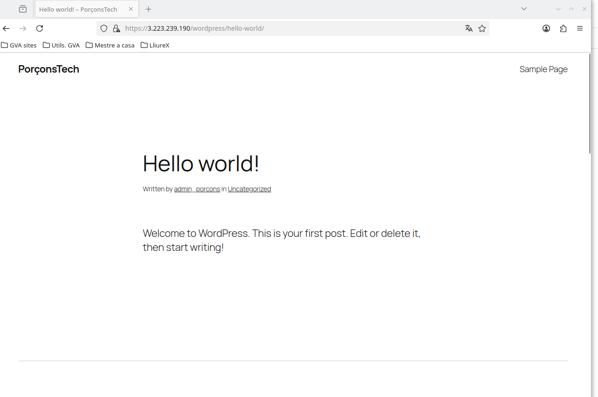

He canviat els enllaços permanents amb `wp rewrite structure '/%postname%/' --hard` i `wp rewrite flush`, i he mirat el resultat amb `wp option get permalink_structure`.

Al principi donava 404 perquè WP-CLI no va poder crear el `.htaccess` i, a més, Apache tenia `AllowOverride None`. He creat el `.htaccess` a mà i he afegit un fitxer de configuració d'Apache (`wordpress.conf`) amb `AllowOverride All` per a la carpeta de WordPress. Després d'això l'entrada "Hello world!" s'obri amb `https://3.223.239.190/wordpress/hello-world/` en lloc de `/?p=1`, com es veu a la captura del navegador.

---

## E6 · Portal final

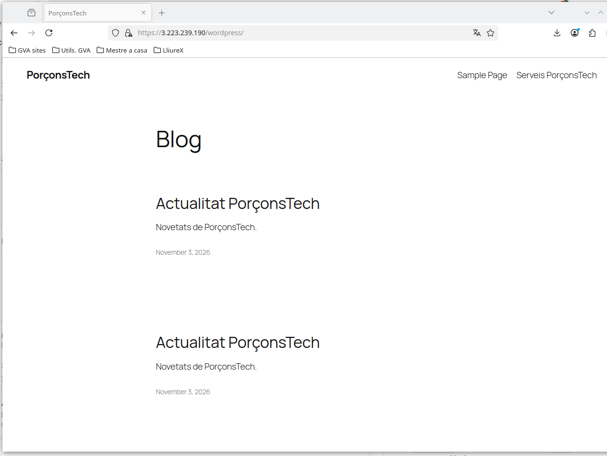

Per a veure que tot seguia funcionant he fet `wp core version`, `wp db check` (totes les taules en OK), `wp plugin list` i `wp theme list`, i he entrat al portal i al panell des del navegador.

---

## Taules i preguntes de la pràctica

### Rols (pas 6.4)

| Acció | Administrador | Editor | Autor |
|---|---|---|---|
| Crear entrades | Sí | Sí | Sí |
| Editar entrades pròpies | Sí | Sí | Sí |
| Editar entrades d'altres usuaris | Sí | Sí | No |
| Instal·lar plugins | Sí | No | No |
| Gestionar usuaris | Sí | No | No |
| Modificar temes | Sí | No | No |

### Backup (pas 7)

1. Guardar només `/var/www/html` no val perquè els continguts (entrades, pàgines, usuaris) estan a la base de dades.
2. Sense la base de dades perdríem totes les entrades, pàgines, usuaris i la configuració del lloc.
3. Si només tinguérem la base de dades perdríem els temes, plugins, imatges pujades i el `wp-config.php`.
4. Els backups han d'estar fora de `/var/www/html` perquè eixa carpeta és pública i algú podria descarregar-los des del navegador, i perquè si el servidor falla es perdrien amb ell.

### Backup o exportació (pas 8)

| Característica | Backup | Exportació WordPress |
|---|---|---|
| Inclou la base de dades completa | Sí | No |
| Inclou plugins | Sí | No |
| Inclou temes | Sí | No |
| Inclou entrades i pàgines | Sí | Sí |
| Permet traslladar continguts | Sí, però poc pràctic | Sí |
| Serveix per recuperar tot el lloc després d'una avaria | Sí | No |

- A (servidor avariat): backup, perquè té fitxers i base de dades.
- B (passar les entrades a un altre WordPress): exportació WXR.
- C (conservar plugins, temes, configuració i base de dades): backup.
- D (copiar només alguns continguts): exportació WXR, perquè es poden triar amb `--post__in`.

Sobre els formats: el WXR/XML és el millor per a migrar entre WordPress, el CSV per a obrir-lo en un full de càlcul i el JSON per a què el use una aplicació.

### RSS (pas 9)

He comprovat el feed amb `curl` a `https://3.223.239.190/wordpress/feed/` i he canviat `posts_per_rss` de 10 a 5. Després he publicat l'entrada "Actualitat PorçonsTech" i he vist que apareixia al feed. Al navegador el feed es descarrega en lloc de mostrar-se, però el XML està bé.

### Informe d'accessos (pas 10)

Està al fitxer [`informe-accessos.txt`](informe-accessos.txt).

---

## Tasques finals

**1. WP-CLI.** Dos avantatges: es poden automatitzar tasques amb scripts, i es pot administrar el servidor per SSH sense interfície gràfica, de forma més ràpida que amb el panell.

**2. Plugins.** Per a incorporar una funcionalitat nova: el instal·laria amb `wp plugin install NOM`, l'activaria amb `wp plugin activate NOM`, miraria amb `wp plugin list` que està actiu i provaria que funciona al navegador, l'actualitzaria amb `wp plugin update NOM`, i si ja no fa falta el desactivaria i l'eliminaria amb `wp plugin delete NOM`.

**3. Usuaris.** L'administradora del sistema seria Administrador, perquè ha de gestionar tot el lloc. La persona que revisa i publica continguts seria Editor, perquè pot publicar i editar les entrades d'altres però no toca plugins ni usuaris. La que només publica les seues entrades seria Autor. Així cadascú té només els permisos que necessita.

**4. Actualitzacions.** S'han d'actualitzar WordPress, plugins i temes per seguretat, per corregir errors i per mantindre la compatibilitat. Abans d'una actualització important faria un backup, miraria que els plugins i el tema són compatibles amb la versió nova i que la versió de PHP del servidor val, i si pogués ho provaria abans en un entorn de proves.

**5. Backup i exportació.** La còpia de seguretat completa té fitxers i base de dades i serveix per a recuperar tot el lloc si falla el servidor. L'exportació WXR només porta continguts (entrades, pàgines, autors) i serveix per a passar-los a un altre WordPress. El CSV i el JSON són només dades: el CSV va bé per a analitzar-les en un full de càlcul i el JSON perquè les use una aplicació.

**6. Sindicació.** Un canal RSS és un XML que WordPress genera amb les últimes entrades publicades, i està a `/feed/`. Una altra aplicació, com un lector RSS o un altre web, pot consultar-lo cada cert temps i veure les novetats de PorçonsTech sense copiar-les a mà.

**7. Anàlisi d'accessos.** Del `access.log` es pot traure la IP del client, la data i hora, el mètode i el recurs que demana, i el codi de resposta. A l'administrador li serveix per a detectar errors (molts 404, per exemple), veure quines pàgines es visiten més i detectar coses sospitoses, com molts intents sobre `/wp-login.php` o `/wp-admin`. Les IP són dades personals i cal tractar-les segons la normativa de protecció de dades.
