# Projecte 2 · Administració de WordPress amb WP-CLI

**Oscar Bravo Villada · IAW · PorçonsTech**

Aquest projecte l'he fet en una instància d'AWS amb Ubuntu 24.04, Apache, PHP 8.3 i MariaDB. Com que a /var/www/html ja hi havia una altra aplicació PHP (add.php, edit.php, etc.), he instal·lat WordPress en una subcarpeta, /var/www/html/wordpress, i totes les ordres wp les he executades des d'ahí. La versió de WordPress és la 7.1.4 i la de WP-CLI la 2.12.0.

Les captures estan a la carpeta imatges/.

---

## E1 · WP-CLI instal·lat

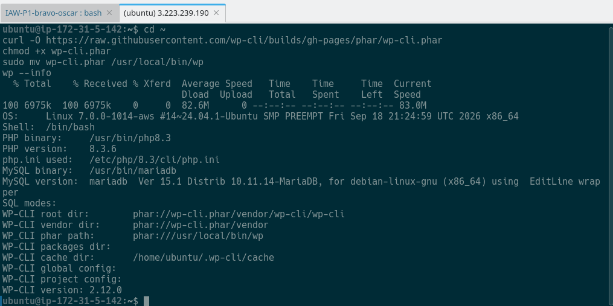

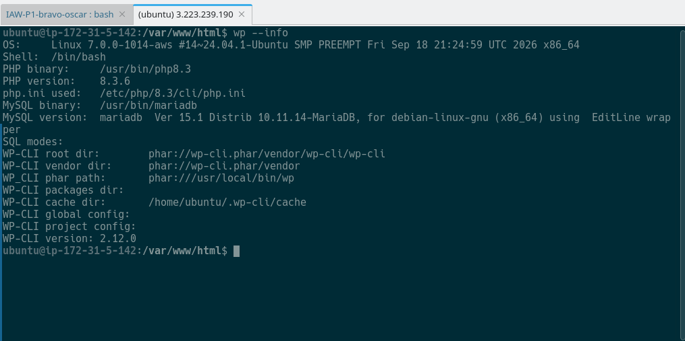

WP-CLI és una eina per a administrar WordPress des del terminal. A la primera captura es veu com el descarregue amb curl, li done permisos d'execució i el moc a /usr/local/bin/wp. A la segona, wp --info mostra que funciona i que detecta PHP 8.3.6 i MariaDB 10.11.

L'avantatge respecte a wp-admin és que ho puc fer tot per SSH sense navegador, és més ràpid i les ordres es poden posar en scripts per a automatitzar tasques.

---

## E2 · Plugins

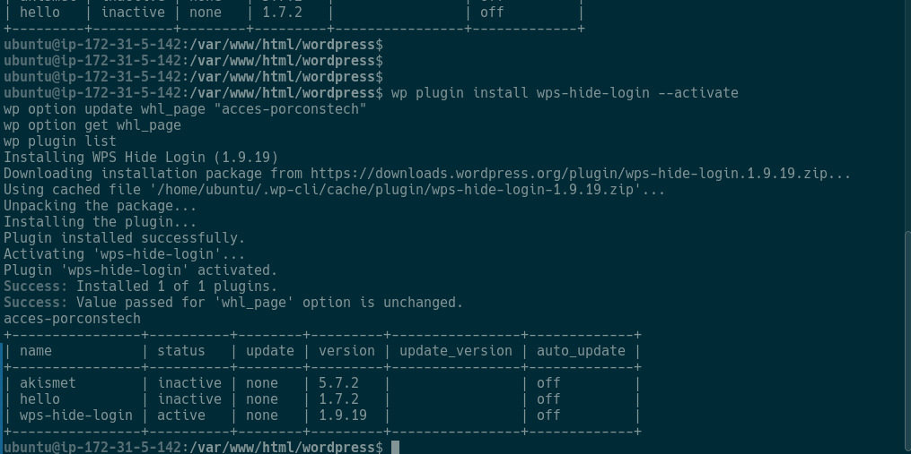

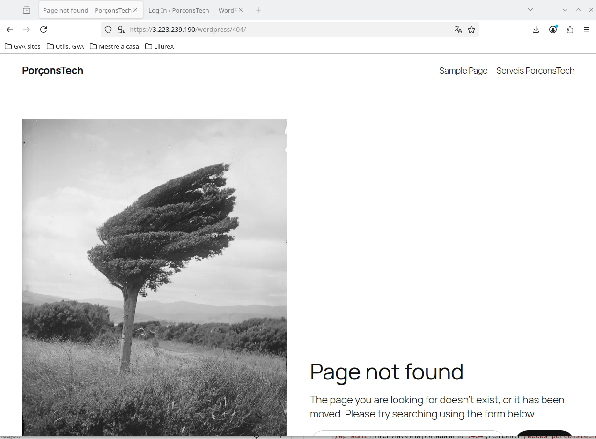

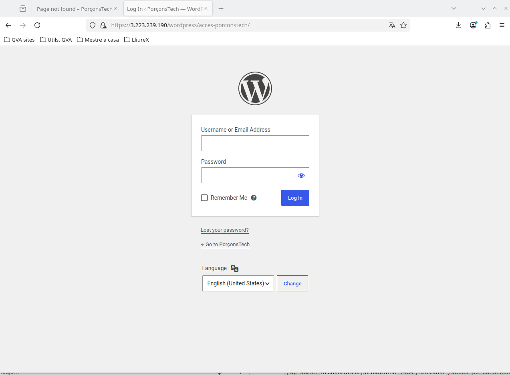

He treballat amb el plugin wps-hide-login. A la primera captura es veu com l'instal·le i l'active amb wp plugin install wps-hide-login --activate, com canvie la ruta d'accés amb wp option update whl_page "acces-porconstech" i el wp plugin list amb el plugin en estat active. El missatge option is unchanged ix perquè aquesta opció ja l'havia configurada abans en una prova anterior. Al final també l'he desactivat, activat, actualitzat i eliminat per a veure el cicle complet.

Per a comprovar que de veres funcionava ho he provat al navegador (segona captura): entrant a /wp-admin m'enviava a la portada amb ?404, i en canvi /acces-porconstech em mostrava el login.

---

## E3 · Temes

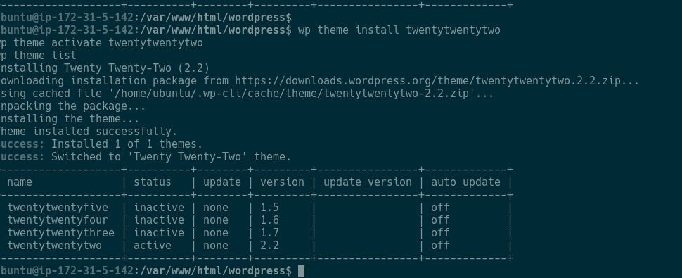

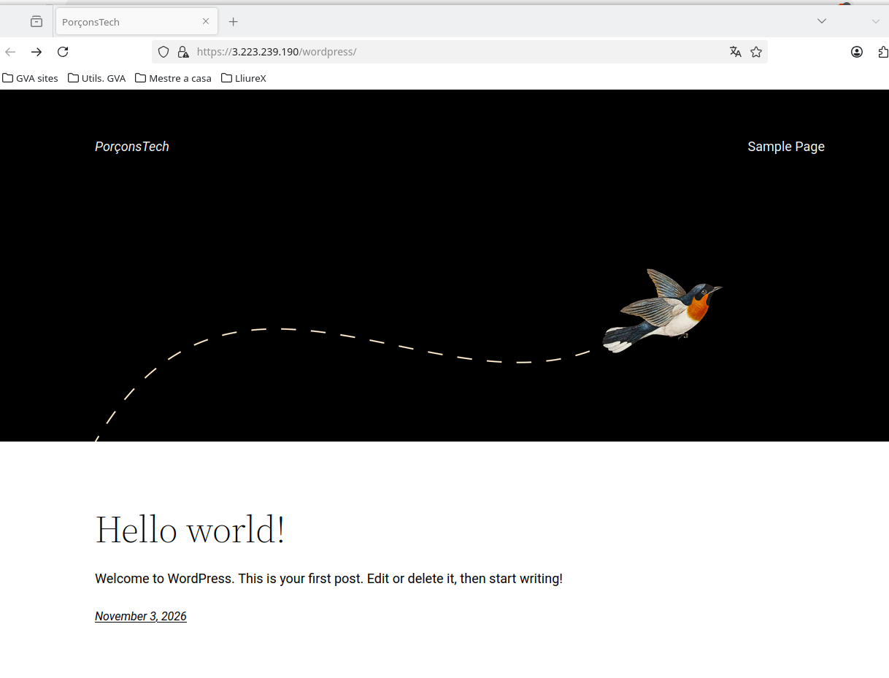

He instal·lat el tema twentytwentytwo (versió 2.2) amb wp theme install i l'he activat amb wp theme activate. A la primera captura es veu el wp theme list amb aquest tema com a active, i a la segona el portal al navegador amb l'aspecte nou (capçalera negra amb l'ocell). Quan he acabat he tornat a activar el tema original (twentytwentyfive) i he esborrat el de prova, i això es veu a la part de dalt de la captura d'E4.

Per a saber quin tema està actiu es fa wp theme list i es mira la columna status, on posa active.

---

## E4 · Actualitzacions

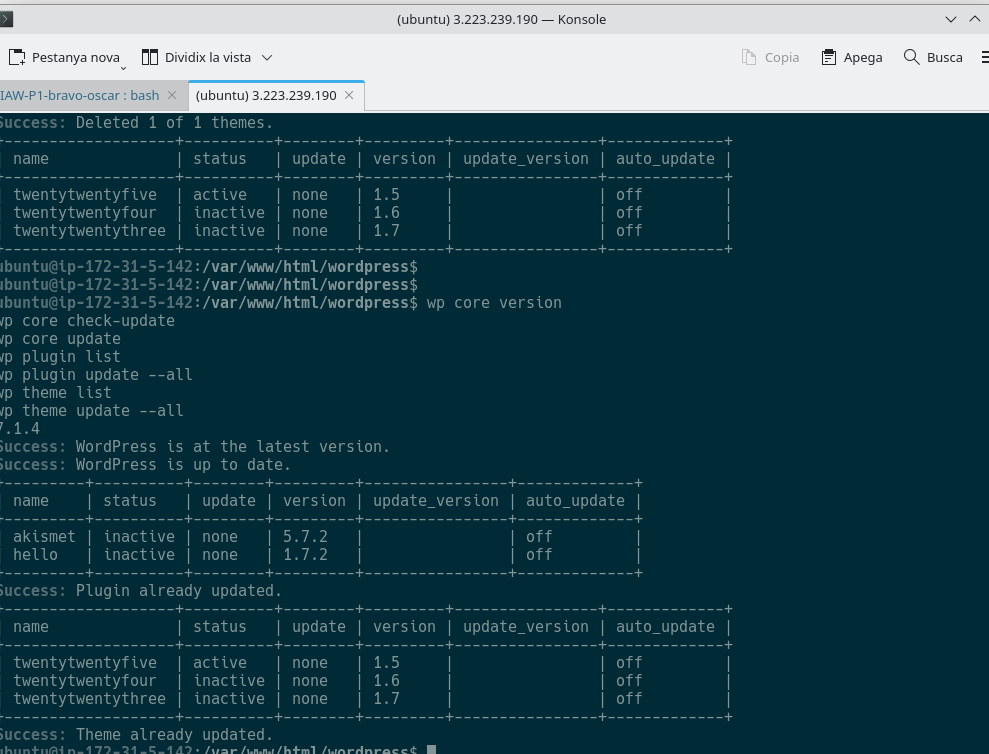

A la captura es veuen wp core version (7.1.4), wp core check-update, wp core update, wp plugin list, wp plugin update --all, wp theme list i wp theme update --all. WordPress ja estava a l'última versió i no hi havia res pendent en plugins ni temes, per això els missatges diuen "up to date" i "already updated".

És important actualitzar-ho tot perquè les versions noves arreglen errors i sobretot problemes de seguretat. Un plugin o tema antic és de les maneres més fàcils d'entrar en un WordPress.

---

## E5 · Configuració amb WP-CLI

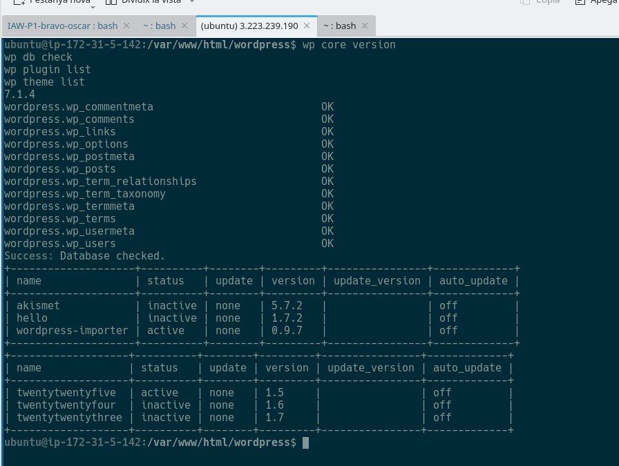

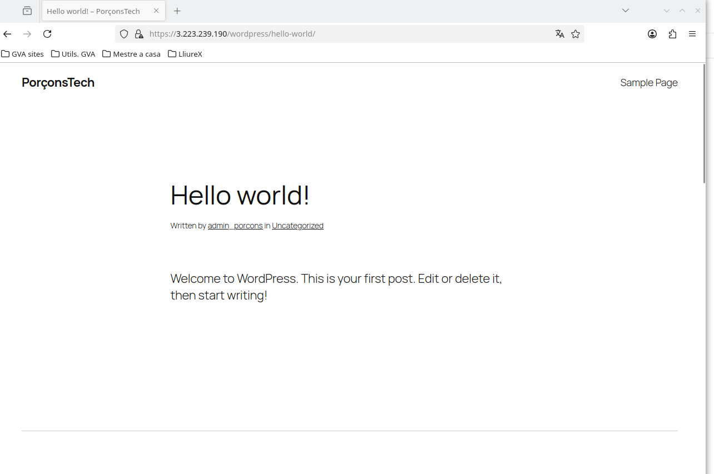

He canviat els enllaços permanents amb wp rewrite structure '/%postname%/' --hard i wp rewrite flush, i he mirat el resultat amb wp option get permalink_structure.

Al principi donava 404 perquè WP-CLI no va poder crear el .htaccess i, a més, Apache tenia AllowOverride None. He creat el .htaccess a mà i he afegit un fitxer de configuració d'Apache (wordpress.conf) amb AllowOverride All per a la carpeta de WordPress. Després d'això l'entrada "Hello world!" s'obri amb https://3.223.239.190/wordpress/hello-world/ en lloc de /?p=1, com es veu a la captura del navegador.

---

## E6 · Portal final

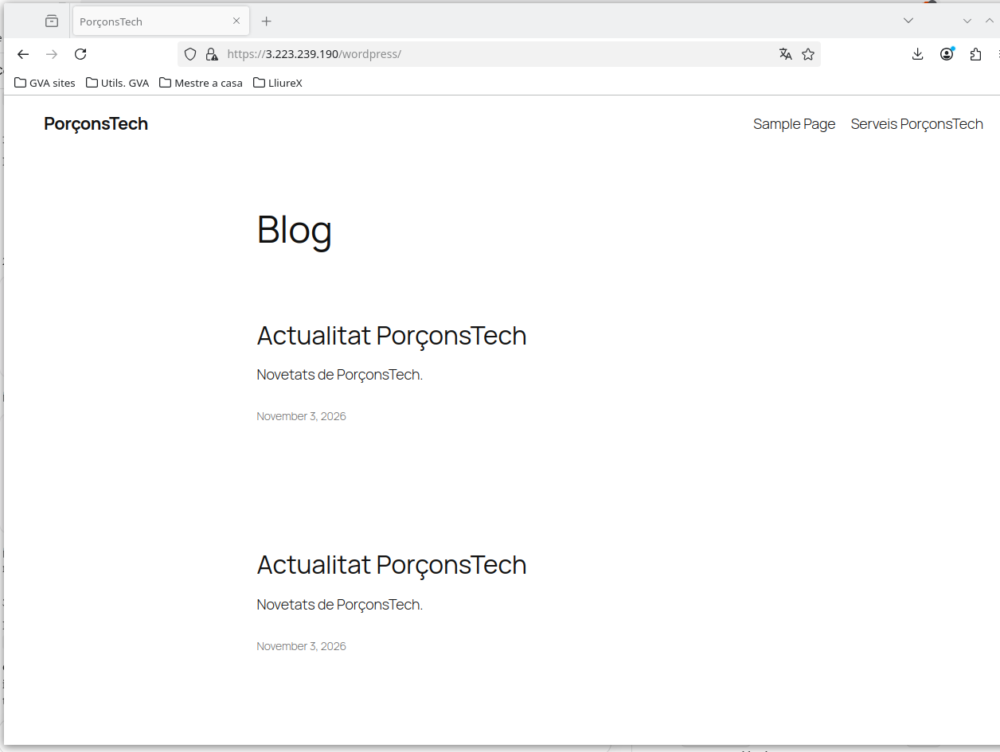

Per a veure que tot seguia funcionant he fet wp core version, wp db check (totes les taules en OK), wp plugin list i wp theme list, i he entrat al portal i al panell des del navegador.

---

## Pas 6 · Usuaris i perfils

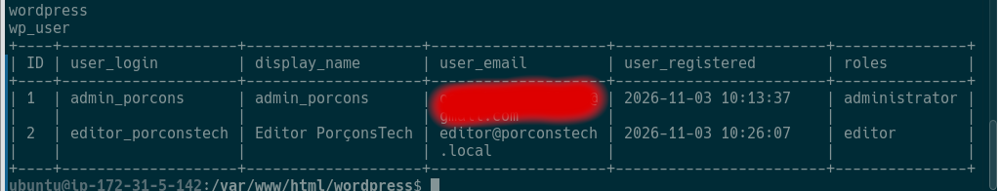

He consultat els usuaris amb `wp user list` i he creat dos usuaris nous amb rols diferents:

```bash
wp user create editor_porconstech editor@porconstech.local --role=editor --user_pass='********'
wp user create autor_porconstech autor@porconstech.local --role=author --user_pass='********'
```

Després he canviat el rol de l'autor a editor amb `wp user set-role autor_porconstech editor`, he modificat el nom visible de l'editor amb `wp user update editor_porconstech --display_name="Editor PorçonsTech"` i l'he comprovat amb `wp user get`. Finalment he esborrat l'usuari de prova amb `wp user delete autor_porconstech --reassign=1`, reassignant el seu contingut a l'administrador (ID 1). A la captura es veuen els dos usuaris que queden: `admin_porcons` (administrator) i `editor_porconstech` (editor, amb el nom "Editor PorçonsTech").

### Rols (pas 6.4)

| Acció | Administrador | Editor | Autor |
|---|---|---|---|
| Crear entrades | Sí | Sí | Sí |
| Editar entrades pròpies | Sí | Sí | Sí |
| Editar entrades d'altres usuaris | Sí | Sí | No |
| Instal·lar plugins | Sí | No | No |
| Gestionar usuaris | Sí | No | No |
| Modificar temes | Sí | No | No |

Això és el principi de mínim privilegi: cadascú només té els permisos que necessita per a la seua feina.

---

## Pas 7 · Backup

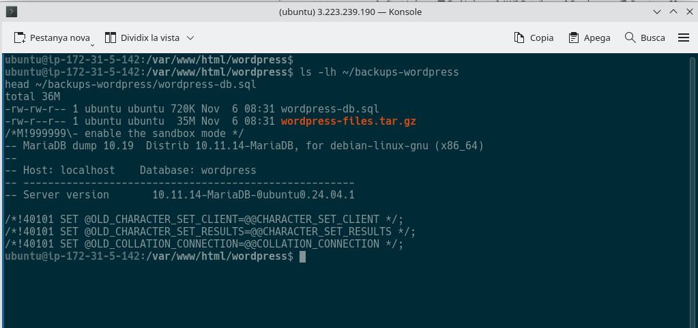

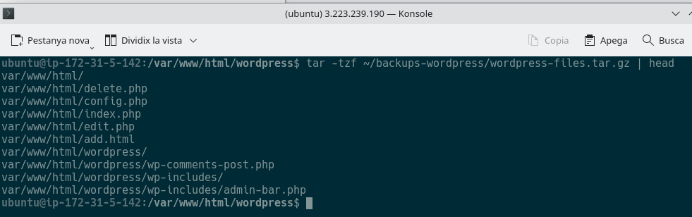

Un WordPress té dues parts, els fitxers i la base de dades, així que el backup ha d'incloure les dues. Ho he fet així:

```bash
mkdir -p ~/backups-wordpress
sudo tar -czf ~/backups-wordpress/wordpress-files.tar.gz /var/www/html
wp db export ~/backups-wordpress/wordpress-db.sql
ls -lh ~/backups-wordpress
tar -tzf ~/backups-wordpress/wordpress-files.tar.gz | head
head ~/backups-wordpress/wordpress-db.sql
```

A les captures es veuen els dos fitxers (wordpress-files.tar.gz de 35M i wordpress-db.sql de 720K), que el tar es pot llegir i que el .sql comença amb el dump de MariaDB de la base de dades wordpress. Els backups estan a ~/backups-wordpress, fora de /var/www/html.

**Preguntes:**

1. Guardar només /var/www/html no val perquè els continguts (entrades, pàgines, usuaris) estan a la base de dades.
2. Sense la base de dades perdríem totes les entrades, pàgines, usuaris i la configuració del lloc.
3. Si només tinguérem la base de dades perdríem els temes, plugins, imatges pujades i el wp-config.php.
4. Els backups han d'estar fora de /var/www/html perquè eixa carpeta és pública i algú podria descarregar-los des del navegador, i perquè si el servidor falla es perdrien amb ell.

---

## Pas 8 · Importar i exportar continguts

Primer he mirat els continguts amb `wp post list`. La pàgina "Serveis PorçonsTech" té l'ID 7 i l'entrada "Benvinguts a PorçonsTech" l'ID 8.

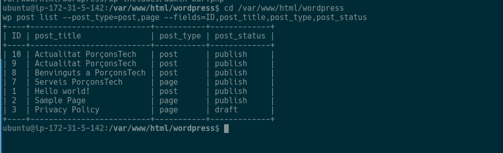

**Exportar.** He exportat només eixos dos continguts en format WXR. Cal posar la ruta completa a `--dir`, perquè amb `~` WP-CLI deia que el directori no existia.

```bash
mkdir -p ~/exports-wordpress
wp export --post__in=7,8 --dir=/home/ubuntu/exports-wordpress
```

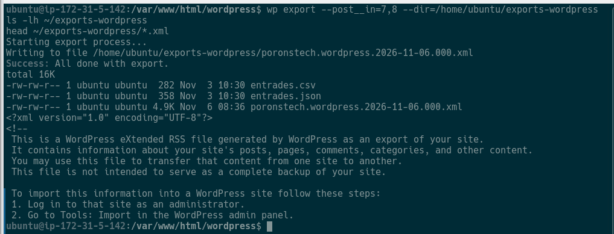

**Esborrar.** Amb el plugin WordPress Importer ja instal·lat i actiu (`wp plugin install wordpress-importer --activate`), he esborrat els dos continguts:

```bash
wp post delete 7 8 --force
```

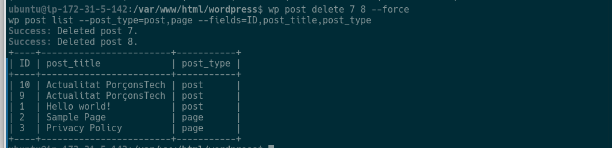

**Importar.**

```bash
wp import ~/exports-wordpress/poronstech.wordpress.2026-11-06.000.xml --authors=create
```

L'eixida de la importació va ser:

```text
Processing post #7 ("Serveis PorçonsTech") (post_type: page)
-- Imported post as post_id #7
Processing post #8 ("Benvinguts a PorçonsTech") (post_type: post)
-- Imported post as post_id #8
Success: Finished importing from '/home/ubuntu/exports-wordpress/poronstech.wordpress.2026-11-06.000.xml' file.
```

Després he tornat a fer `wp post list` i els dos continguts han tornat en estat publish, amb els mateixos IDs (7 i 8):

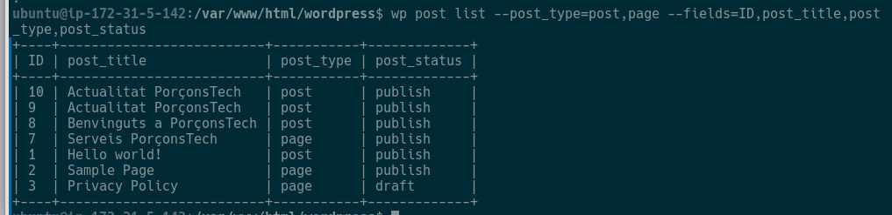

### Backup o exportació (pas 8.5)

| Característica | Backup | Exportació WordPress |
|---|---|---|
| Inclou la base de dades completa | Sí | No |
| Inclou plugins | Sí | No |
| Inclou temes | Sí | No |
| Inclou entrades i pàgines | Sí | Sí |
| Permet traslladar continguts | Sí, però poc pràctic | Sí |
| Serveix per recuperar tot el lloc després d'una avaria | Sí | No |

- **A (servidor avariat):** backup, perquè té fitxers i base de dades.
- **B (passar les entrades a un altre WordPress):** exportació WXR.
- **C (conservar plugins, temes, configuració i base de dades):** backup.
- **D (copiar només alguns continguts):** exportació WXR, perquè es poden triar amb --post__in.

### Altres formats (CSV i JSON)

```bash
wp post list --post_type=post --fields=ID,post_title,post_content,post_status --format=csv > ~/exports-wordpress/entrades.csv
wp post list --post_type=post --fields=ID,post_title,post_content,post_status --format=json > ~/exports-wordpress/entrades.json
```

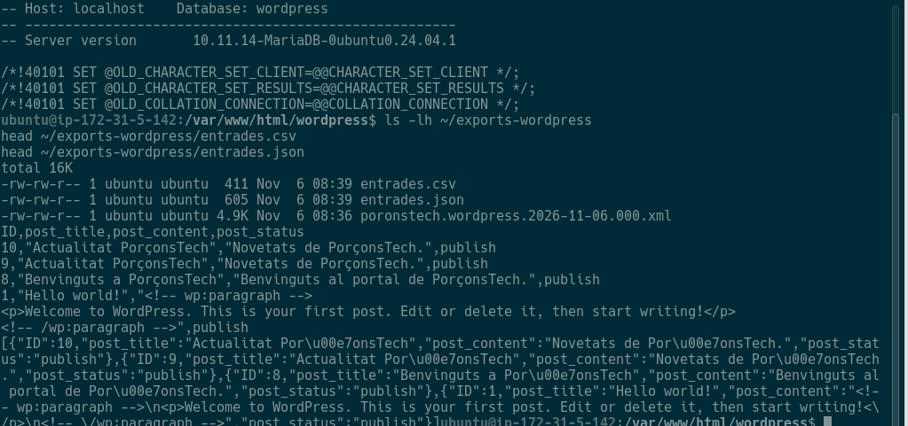

El WXR/XML és el millor per a migrar entre WordPress, el CSV per a obrir-lo en un full de càlcul i el JSON perquè el puga utilitzar una aplicació. Al JSON la "ç" ix com `\u00e7`, i és normal.

---

## Pas 9 · RSS

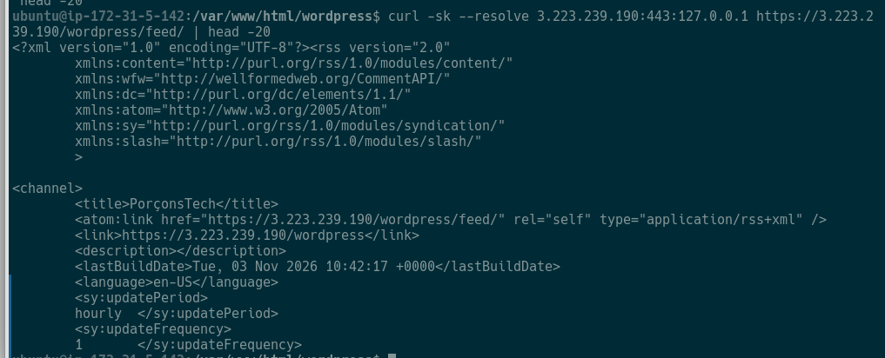

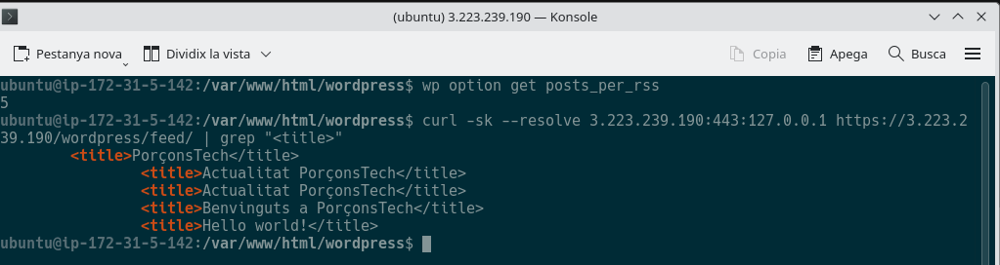

Des del propi servidor no em puc connectar a la IP pública d'AWS (el curl es quedava penjat), així que he comprovat el feed forçant la IP a localhost amb `--resolve`:

```bash
curl -sk --resolve 3.223.239.190:443:127.0.0.1 https://3.223.239.190/wordpress/feed/ | head -20
wp option get posts_per_rss
wp option update posts_per_rss 5
curl -sk --resolve 3.223.239.190:443:127.0.0.1 https://3.223.239.190/wordpress/feed/ | grep "<title>"
```

El feed és un XML amb `<rss>`, `<channel>` i `<title>PorçonsTech</title>`. He canviat posts_per_rss de 10 a 5, i a les captures es veu el valor 5 i els títols de les entrades publicades ("Actualitat PorçonsTech" dues vegades, "Benvinguts a PorçonsTech" i "Hello world!"). Al navegador el feed es descarrega en lloc de mostrar-se, però el XML està bé.

---

## Pas 10 · Informe d'accessos

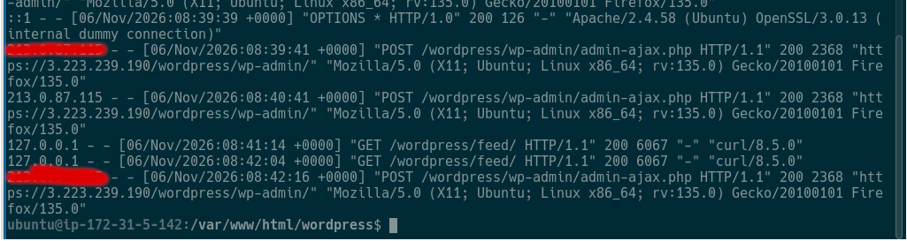

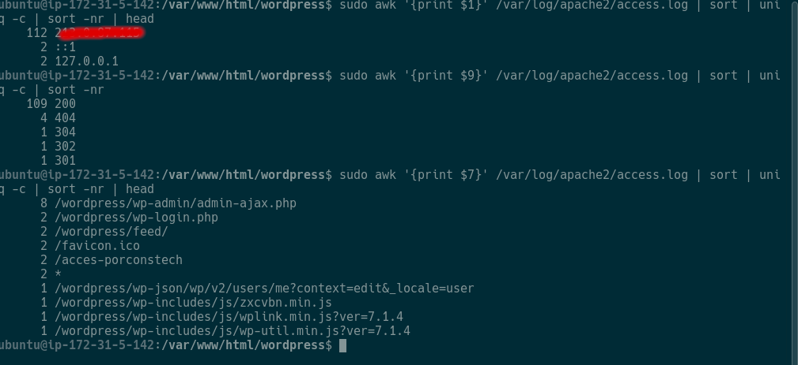

He consultat /var/log/apache2/access.log amb `sudo tail -n 20` i he analitzat les IP, els codis HTTP i els recursos més sol·licitats amb `awk`, `sort` i `uniq -c`:

```bash
sudo awk '{print $1}' /var/log/apache2/access.log | sort | uniq -c | sort -nr | head
sudo awk '{print $9}' /var/log/apache2/access.log | sort | uniq -c | sort -nr
sudo awk '{print $7}' /var/log/apache2/access.log | sort | uniq -c | sort -nr | head
```

De 116 peticions, 112 són d'una sola IP externa (la meua), 109 han donat 200 i 4 han donat 404. L'informe complet està al fitxer [informe-accessos.txt](informe-accessos.txt).

---

## Tasques finals

### 1. Administració amb WP-CLI
Dos avantatges: puc administrar tot el WordPress per SSH sense necessitat de navegador ni d'entrar al panell, i les ordres es poden posar en scripts per a automatitzar tasques repetitives (backups, actualitzacions, etc.), cosa que des de wp-admin no es pot fer.

### 2. Plugins
Si PorçonsTech necessita una funcionalitat nova, faria això:
1. **Instal·lar:** `wp plugin install nom-del-plugin`. Abans miraria que siga del repositori oficial, que estiga actualitzat i que tinga bones valoracions.
2. **Activar:** `wp plugin activate nom-del-plugin` (o amb `--activate` en la mateixa ordre d'instal·lar).
3. **Comprovar que funciona:** `wp plugin list` per a veure que està en estat active, i després provar la funcionalitat al navegador. Amb wps-hide-login ho vaig comprovar entrant a la nova URL.
4. **Actualitzar:** `wp plugin update nom-del-plugin`, o `--all` per a tots. Abans faria un backup.
5. **Eliminar:** si ja no cal, primer `wp plugin deactivate` i després `wp plugin delete`. Un plugin que no es fa servir és una porta oberta innecessària.

### 3. Usuaris i permisos
- **Administradora del sistema → Administrador.** Necessita gestionar tot el lloc: plugins, temes, usuaris i configuració.
- **Persona que revisa i publica continguts → Editor.** Pot crear, editar i publicar les entrades de tothom, però no pot instal·lar plugins ni gestionar usuaris.
- **Persona que només publica les seues entrades → Autor.** Només pot crear, editar i publicar les seues pròpies entrades.

Ho he decidit pel principi de mínim privilegi: cadascú té només els permisos que necessita. Així, si un compte es veu compromés o algú es confon, el dany és menor.

### 4. Actualitzacions
Cal mantindre actualitzats WordPress, els plugins i els temes perquè les versions noves arreglen errors i sobretot problemes de seguretat, i un plugin o tema antic és de les maneres més fàcils d'entrar en un WordPress. Abans d'una actualització important faria un backup complet (fitxers i base de dades), miraria si el tema i els plugins són compatibles amb la versió nova, llegiria les notes de la versió i, si pogués, ho provaria primer en un entorn de proves. Després comprovaria que el portal i el panell continuen funcionant.

### 5. Backup i exportació
- **Còpia de seguretat completa:** fitxers més base de dades (jo he fet un tar.gz i un wp db export). Serveix per a recuperar tot el lloc si el servidor s'avaria.
- **Exportació WXR/XML:** només conté continguts (entrades, pàgines, autors, categories). Serveix per a passar continguts d'un WordPress a un altre, o per a copiar només alguns. No inclou plugins, temes ni la configuració.
- **Exportació CSV o JSON:** és una llista de dades sense l'estructura de WordPress. El CSV és útil per a obrir-lo en un full de càlcul i analitzar-lo, i el JSON perquè el puga consumir una altra aplicació. No serveix per a importar-lo directament en un altre WordPress.

### 6. Sindicació
Un canal RSS és un document XML que WordPress genera automàticament amb les últimes entrades publicades (títol, enllaç, resum, data). El nostre és /wordpress/feed/. En lloc de copiar les notícies a mà, una altra aplicació o un lloc web pot consultar eixa adreça cada cert temps i mostrar les novetats de PorçonsTech tot sol. Un lector RSS també s'hi pot subscriure per a avisar quan hi haja una entrada nova. En el meu cas vaig canviar posts_per_rss a 5, i en publicar "Actualitat PorçonsTech" va aparéixer al feed.

### 7. Anàlisi d'accessos
Del access.log es pot traure la IP del client, la data i hora, el mètode i el recurs que demana, i el codi de resposta. A l'administrador li serveix per a detectar errors (molts 404, per exemple), veure quines pàgines es visiten més i detectar coses sospitoses, com molts intents sobre /wp-login.php o /wp-admin. Les IP són dades personals i cal tractar-les segons la normativa de protecció de dades.
