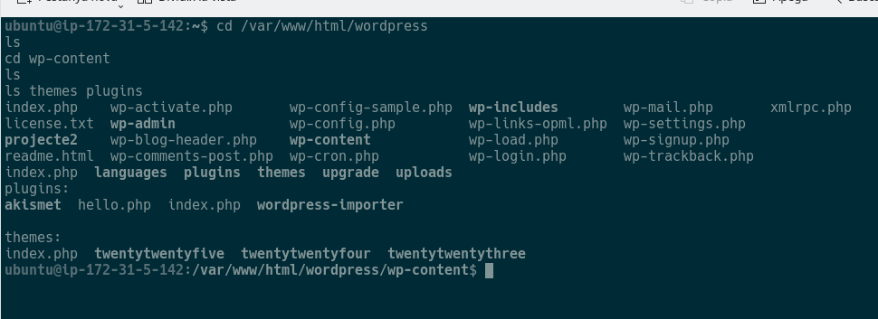
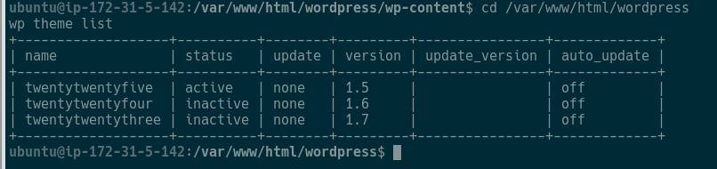
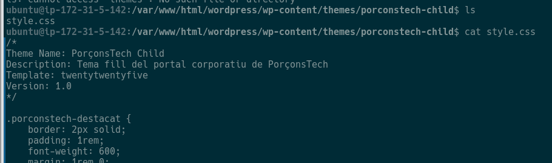
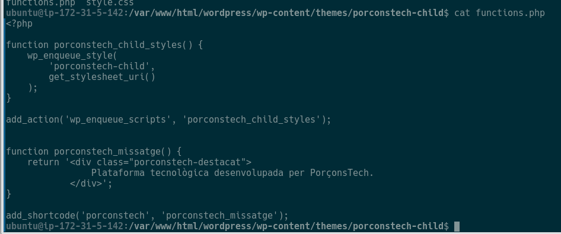
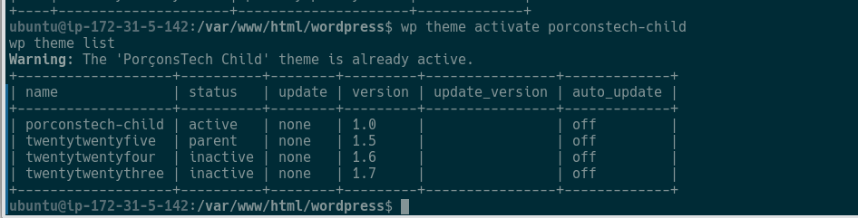
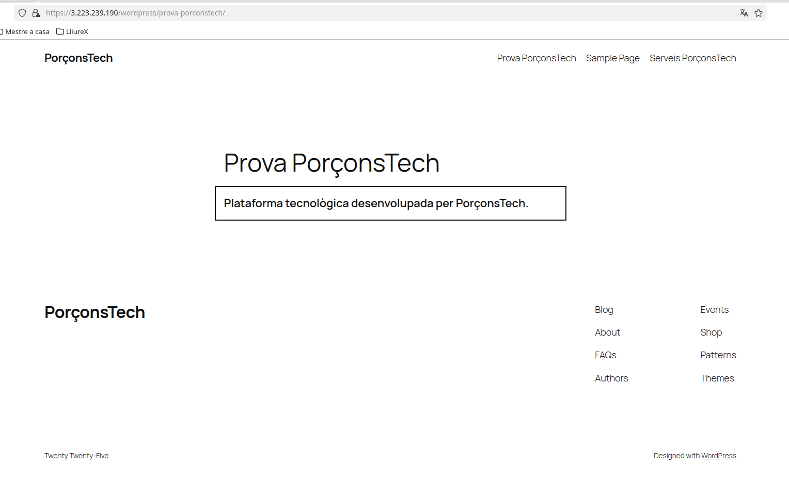
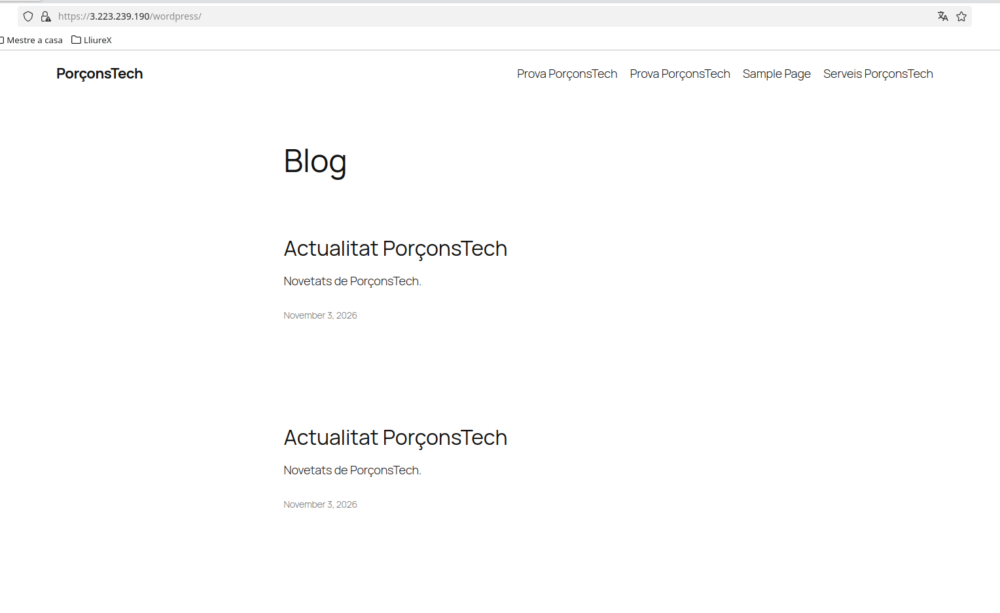
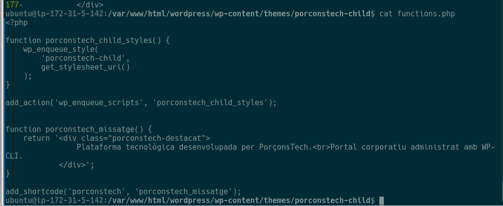

# Projecte 2 · Sprint 3 · Adaptar WordPress

**Oscar Bravo Villada · IAW · PorçonsTech**

En aquest sprint he adaptat WordPress tocant codi, però sense modificar el tema original: he creat un tema fill amb un canvi d'estil i un shortcode propi. Recorde que el WordPress no està a /var/www/html sinó a /var/www/html/wordpress, perquè a /var/www/html ja tenia una altra aplicació PHP. Per això totes les rutes porten la subcarpeta. La versió de WordPress és la 7.1.4.

Les captures estan a la carpeta imatges/.

---

## 1. Estructura de WordPress



Primer he entrat per SSH i he fet `ls` a /var/www/html/wordpress i després dins de wp-content. Allà es veuen wp-admin, wp-content, wp-includes i wp-config.php, i dins de wp-content les carpetes plugins i themes.

| Element | Per a què serveix |
|---|---|
| `wp-content/themes` | Hi estan els temes instal·lats, que són els que decideixen l'aspecte del lloc. |
| `wp-content/plugins` | Hi estan els plugins, que afegeixen funcions que WordPress no porta de sèrie. |
| `wp-content/uploads` | Guarda el que pugem des de WordPress: imatges, documents, etc. |
| `wp-config.php` | És la configuració principal: la connexió a la base de dades, les claus de seguretat i el prefix de les taules. |

---

## 2. Quin és el tema actiu



Amb `wp theme list` he mirat quin tema estava en estat active, i era **twentytwentyfive**. Eixe nom (el slug) és el que he de posar després en el tema fill, no el nom que es veu al panell.

---

## 3. Què vaig a canviar

| Modificació | Fitxer | Què vull aconseguir |
|---|---|---|
| Canvi visual | `style.css` | Que un missatge de PorçonsTech es veja destacat |
| Funcionalitat nova | `functions.php` | Crear el shortcode `[porconstech]` |

---

## 4. El tema fill i el style.css



He creat la carpeta del tema fill dins de themes:

```bash
cd /var/www/html/wordpress/wp-content/themes
mkdir porconstech-child
cd porconstech-child
```

I he escrit el style.css. La línia `Template` és la que enllaça amb el tema pare:

```css
/*
Theme Name: PorçonsTech Child
Description: Tema fill del portal corporatiu de PorçonsTech
Template: twentytwentyfive
Version: 1.0
*/

.porconstech-destacat {
    border: 2px solid;
    padding: 1rem;
    font-weight: 600;
    margin: 1rem 0;
}
```

---

## 5. El functions.php



```php
<?php

function porconstech_child_styles() {
    wp_enqueue_style(
        'porconstech-child',
        get_stylesheet_uri()
    );
}

add_action('wp_enqueue_scripts', 'porconstech_child_styles');


function porconstech_missatge() {
    return '<div class="porconstech-destacat">
                Plataforma tecnològica desenvolupada per PorçonsTech.
            </div>';
}

add_shortcode('porconstech', 'porconstech_missatge');
```

El tema fill queda amb només dos fitxers:

```text
porconstech-child/
├── style.css
└── functions.php
```

El style.css s'ocupa de l'aspecte: defineix la classe `.porconstech-destacat` amb la vora, el farciment, la negreta i el marge. El functions.php afegeix la part de codi: carrega l'estil del tema fill i registra el shortcode. I el motiu de fer-ho en un tema fill és que així no toque cap fitxer del tema pare, i si WordPress l'actualitza no perd els meus canvis.

---

## 6. Activar el tema fill



```bash
cd /var/www/html/wordpress
wp theme list
wp theme activate porconstech-child
wp theme list
```

Abans d'activar-lo ja apareixia a la llista com a inactive, i després de l'activació ix com a active, com es veu a la captura.

---

## 7. Provar el shortcode



Per a provar-lo he creat una pàgina des del terminal amb el shortcode dins:

```bash
wp post create --post_type=page --post_title="Prova PorçonsTech" --post_status=publish --post_content='[porconstech]'
```

Quan obric la pàgina al navegador (/wordpress/prova-porconstech/) ix el missatge "Plataforma tecnològica desenvolupada per PorçonsTech." dins d'un requadre amb l'estil del style.css.

També he comprovat que la resta continua bé: la portada es veu amb les entrades de sempre, el panell entra, `wp db check` no dóna errors i no he tocat res del tema pare.

---

## 8. La meua modificació





Per a la modificació pròpia he fet dos canvis xicotets, cadascun en el fitxer que toca. En el functions.php he afegit una segona línia al missatge, i en el style.css he canviat la vora a discontínua i amb les cantonades arredonides.

```php
function porconstech_missatge() {
    return '<div class="porconstech-destacat">
                Plataforma tecnològica desenvolupada per PorçonsTech.<br>Portal corporatiu administrat amb WP-CLI.
            </div>';
}
```

```css
.porconstech-destacat {
    border: 3px dashed;
    border-radius: 8px;
    padding: 1rem;
    font-weight: 600;
    margin: 1rem 0;
}
```

Després de guardar he passat `php -l functions.php` per a assegurar-me que no hi havia errors de sintaxi (va dir "No syntax errors detected") i he recarregat la pàgina amb Ctrl+F5, perquè el navegador no usara l'estil antic. El canvi es veu a la captura.

---

## Preguntes finals

**1. Diferència entre `themes`, `plugins` i `uploads` dins de `wp-content`**

A `themes` estan els temes, que marquen l'aspecte. A `plugins` estan els plugins, que afegeixen funcionalitats. I a `uploads` van els fitxers que es pugen des de WordPress, com les imatges.

**2. Funció de `style.css` en el tema fill**

Fa dues coses. La capçalera diu com es diu el tema i quin és el seu pare (amb `Template`), i la resta són els estils CSS propis, com la classe `.porconstech-destacat`.

**3. Funció de `functions.php`**

És on es posa el codi PHP propi del tema. En el nostre cas carrega el style.css del tema fill i crea el shortcode `[porconstech]`.

**4. Els dos fitxers afectats**

`style.css` per al canvi visual i `functions.php` per a la funcionalitat nova.

**5. Què fa el shortcode `[porconstech]`**

Quan WordPress troba `[porconstech]` dins del contingut d'una pàgina, ho canvia pel que torna la funció `porconstech_missatge`: un bloc amb la classe `porconstech-destacat` i el text "Plataforma tecnològica desenvolupada per PorçonsTech."

**6. Per què millor un tema fill que modificar el pare**

Perquè si el tema pare s'actualitza, els canvis fets directament s'esborrarien. Amb el tema fill la meua personalització queda separada i no es perd, i si alguna cosa va mal puc tornar al tema pare sense haver-lo tocat.
