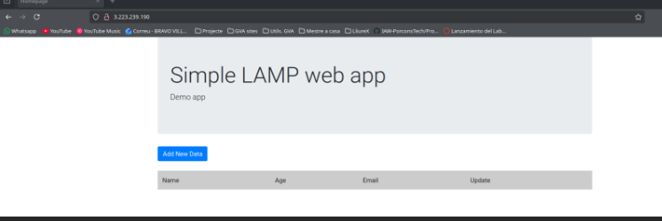
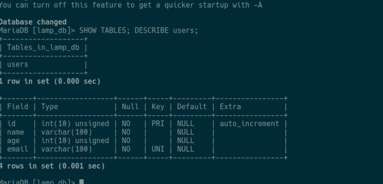
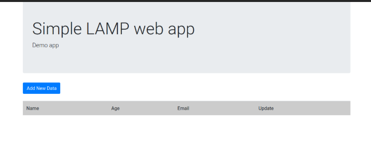
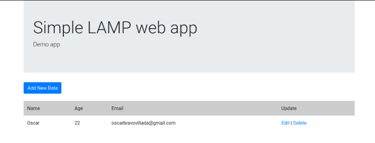
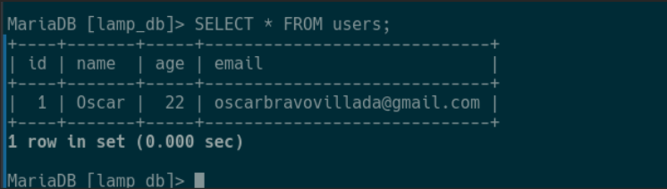

# Sprint 4 · Desplegament d'una aplicació web LAMP

**Implantació d'Aplicacions Web · 2n ASIX**
**Alumne:** Oscar Bravo Villada

En aquest Sprint he desplegat una aplicació web PHP que utilitza una base de dades sobre la mateixa instància EC2 (Ubuntu Server) que ja tenia preparada amb Apache, MySQL i PHP dels Sprints anteriors. L'aplicació és la del repositori [anamollabas/iaw-practica-lamp](https://github.com/anamollabas/iaw-practica-lamp).

---

## E1 · Aplicació publicada

Quan accedisc des del navegador a la IP pública de l'EC2, la petició HTTP arriba a Apache, que escolta pel port 80 (obert al Security Group). Apache detecta que és un fitxer PHP i li passa l'execució a PHP. PHP executa el codi i, si cal, consulta o modifica dades a la base de dades. Després Apache torna al navegador la pàgina HTML ja generada.

---

## E2 · Base de dades preparada

L'aplicació necessita la base de dades `lamp_db` i la taula `users` (amb els camps `id`, `name`, `age` i `email`) perquè és on guarda i d'on llig la informació dels usuaris. Sense aquesta estructura, PHP no tindria on fer les consultes i l'aplicació donaria error en accedir a les dades. He importat l'estructura des del fitxer `sql/estructura.sql`. El gestor instal·lat és MariaDB, compatible amb MySQL.

---

## E3 · Configuració de la connexió

| Paràmetre | Valor o funció |
|---|---|
| `DB_HOST` | `localhost` (el servidor de base de dades està a la mateixa màquina que Apache i PHP) |
| `DB_NAME` | `lamp_db` (base de dades de l'aplicació) |
| `DB_USER` | `lamp_user` (usuari específic de l'aplicació, no `root`) |
| `DB_PASSWORD` | Configurada, **no es publica** |

`localhost` és coherent en aquesta arquitectura perquè tots els components (Apache, PHP i la base de dades) s'executen en el mateix servidor EC2. PHP es connecta de manera local, sense eixir a la xarxa. A GitHub he pujat només `conf/config.example.php`, amb la contrasenya substituïda per un valor fictici (`CAMBIA_AQUI`).

---

## E4 · CRUD verificat

**Abans** (llista buida):

**Després** (he creat un usuari amb «Add New Data»):

**Comprovació a la base de dades:**

He fet una operació **Create**: he afegit un usuari des del formulari de l'aplicació i, després, he consultat la taula `users` directament des de la consola de la base de dades. La fila apareix a MariaDB, la qual cosa demostra que PHP no només mostra dades en pantalla, sinó que les escriu realment a la base de dades.

---

## Fitxers tècnics

- `conf/config.example.php`: configuració de la connexió amb valors fictis.
- `sql/estructura.sql`: estructura de la base de dades (taula `users`).

---

## Preguntes de comprensió

**1. Per què no és suficient que Apache estiga funcionant per a afirmar que l'aplicació completa funciona?**
Perquè Apache només serveix les pàgines. L'aplicació també necessita que PHP s'execute bé i que la base de dades estiga activa i accessible amb les credencials correctes. Apache pot estar funcionant i l'aplicació fallar en consultar les dades.

**2. Quin paper fa PHP entre Apache i MySQL?**
PHP fa d'intermediari: rep la petició d'Apache, executa la lògica de l'aplicació, consulta o modifica dades a la base de dades i genera la resposta que Apache torna al navegador.

**3. Què passarà si `DB_USER` o `DB_PASSWORD` no coincideixen amb les dades configurades a MySQL?**
El servidor de base de dades rebutjarà la connexió (error d'accés denegat) i l'aplicació no podrà llegir ni escriure dades, encara que la pàgina principal es carregue.

**4. Per què utilitzem `localhost` en aquest Sprint per a connectar PHP amb MySQL?**
Perquè PHP i la base de dades estan en la mateixa instància EC2, i per tant la base de dades és local per a PHP.

**5. La pàgina principal es carrega, però apareix un error en consultar dades. Quines tres comprovacions faria primer i en quin ordre?**
1) Comprovar que el servei de base de dades està actiu (`systemctl status mysql`). 2) Revisar que les credencials i el nom de la base de dades del fitxer de configuració coincideixen amb els de MySQL. 3) Comprovar que la base de dades i la taula existeixen i que l'usuari té permisos sobre elles. Si encara falla, miraria el log d'errors d'Apache.

**6. Per què una prova CRUD és una evidència més completa que limitar-se a comprovar que MySQL està actiu?**
Perquè que MySQL estiga actiu només diu que el servei funciona. Una prova CRUD demostra que tota la cadena (navegador, Apache, PHP i base de dades) funciona i que les dades es creen, es lligen, es modifiquen o s'esborren de veritat.
