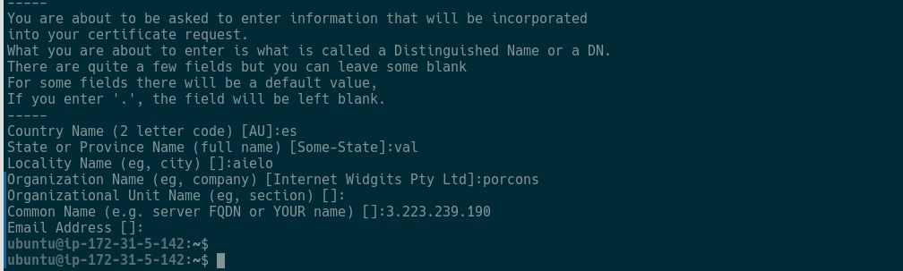
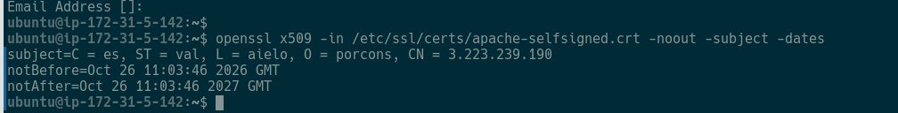
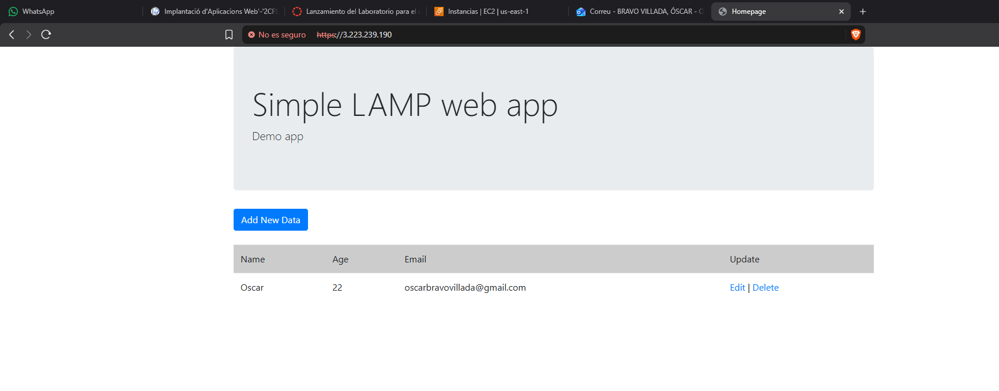
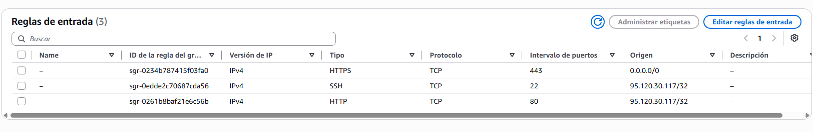
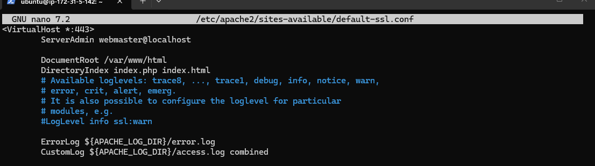
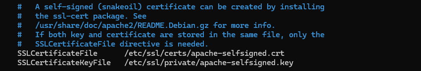
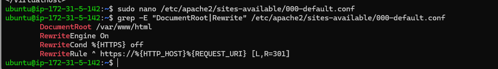
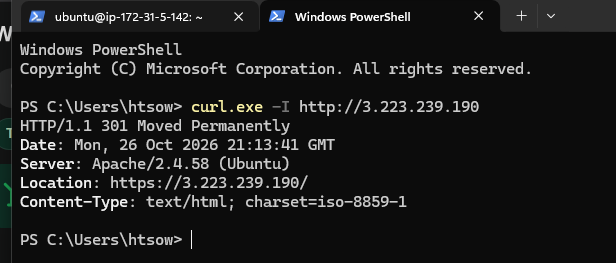

# Sprint 5 · Protegir la infraestructura amb HTTPS

**Implantació d'Aplicacions Web · 2n ASIX**
**Alumne:** Oscar Bravo Villada

En aquest Sprint he protegit l'accés a l'aplicació web amb HTTPS sobre la mateixa instància EC2 (Ubuntu Server) del Sprint anterior. He creat amb OpenSSL una clau privada i un certificat autofirmat, he configurat Apache perquè els utilitze al port 443, he obert aquest port al Security Group i he fet que les peticions HTTP es redirigisquen cap a HTTPS. La IP elàstica de la instància és `3.223.239.190`.

---

## E1 · Certificat creat

Comandes executades:

```bash
sudo openssl req -x509 -nodes -days 365 -newkey rsa:2048 \
  -keyout /etc/ssl/private/apache-selfsigned.key \
  -out /etc/ssl/certs/apache-selfsigned.crt

openssl x509 -in /etc/ssl/certs/apache-selfsigned.crt -noout -subject -dates
```

Dades que he introduït quan OpenSSL les ha demanat (com a Common Name he posat la IP elàstica):



Informació del certificat creat:



| Dada | Valor |
|---|---|
| Subjecte (per a qui s'ha creat) | `C = es, ST = val, L = aielo, O = porcons, CN = 3.223.239.190` |
| Inici de validesa (`notBefore`) | Oct 26 11:03:46 2026 GMT |
| Caducitat (`notAfter`) | Oct 26 11:03:46 2027 GMT |

**Per què el navegador no considera de confiança aquest certificat?**
Perquè l'he signat jo mateix amb OpenSSL: l'emissor i el subjecte són el mateix. Els navegadors només es fien dels certificats signats per una autoritat de certificació (CA) que ja porten en la seua llista de confiança, i aquest no ho està. El navegador no pot verificar que el servidor siga realment qui diu ser, així que mostra l'avís de seguretat, encara que el xifratge funcione igualment.

---

## E2 · HTTPS funcionant

Accés des del navegador a `https://3.223.239.190`. El navegador marca la connexió com a «No és segur» (esperat amb un certificat autofirmat), però l'aplicació es carrega i mostra la fila guardada a la taula `users`, la qual cosa indica que PHP s'executa i continua consultant MariaDB:



Regles d'entrada del Security Group, amb el port 443 obert (a més del 22 i el 80):



**Què hem afegit a la infraestructura per a poder utilitzar HTTPS?**
- Una **clau privada** i un **certificat** creats amb OpenSSL.
- El mòdul **`ssl`** d'Apache (`a2enmod ssl`) i el lloc **`default-ssl.conf`** (`a2ensite`), que defineix un VirtualHost pel port 443.
- Una regla al **Security Group** d'AWS que permet el trànsit **443/TCP**.

Amb això, la comunicació entre el navegador i el servidor passa a anar xifrada amb TLS.

---

## E3 · Configuració d'Apache

**`default-ssl.conf`** (fragment rellevant):

```apache
<VirtualHost *:443>
    DocumentRoot /var/www/html
    DirectoryIndex index.php index.html

    SSLEngine on
    SSLCertificateFile    /etc/ssl/certs/apache-selfsigned.crt
    SSLCertificateKeyFile /etc/ssl/private/apache-selfsigned.key
</VirtualHost>
```





**`000-default.conf`** (fragment rellevant):

```apache
<VirtualHost *:80>
    DocumentRoot /var/www/html

    RewriteEngine On
    RewriteCond %{HTTPS} off
    RewriteRule ^ https://%{HTTP_HOST}%{REQUEST_URI} [L,R=301]
</VirtualHost>
```



**Quina funció tenen `SSLCertificateFile` i `SSLCertificateKeyFile`?**
- `SSLCertificateFile` indica on és el **certificat**: el document públic que Apache envia al navegador en connectar-se i que conté la clau pública i les dades d'identificació del servidor. Es pot compartir.
- `SSLCertificateKeyFile` indica on és la **clau privada**, que correspon a la clau pública del certificat i que Apache utilitza per establir la sessió TLS. Ha de quedar només al servidor, amb accés restringit, i **no es publica mai** (per això no està al repositori).

---

## E4 · Redirecció HTTP → HTTPS

He comprovat la redirecció des del meu PC amb `curl.exe -I http://3.223.239.190`. El servidor respon amb un `301 Moved Permanently` i una capçalera `Location` que apunta a `https://3.223.239.190/`:



**Què fa la regla de redirecció que hem configurat?**
- `RewriteEngine On` activa el motor de reescriptura d'Apache (mòdul `rewrite`).
- `RewriteCond %{HTTPS} off` fa que la regla només s'aplique si la petició **no** ve per HTTPS.
- `RewriteRule ^ https://%{HTTP_HOST}%{REQUEST_URI} [L,R=301]` envia el navegador a la mateixa adreça (mateix host i mateixa ruta) però amb `https://`. `R=301` indica una redirecció permanent i `L` que no s'avalue cap regla més.

---

## Comprovacions finals

- [x] Apache continua actiu (respon a les peticions HTTP i HTTPS).
- [x] El port 443 està permés al Security Group.
- [x] Existeix la clau privada i el certificat.
- [x] Puc consultar les dates de validesa del certificat.
- [x] L'aplicació funciona per HTTPS.
- [x] El navegador avisa que el certificat és autofirmat.
- [x] HTTP redirigeix cap a HTTPS.
- [x] No he publicat la clau privada ni credencials d'AWS.

---

## Fitxers tècnics

- `conf/default-ssl.conf`: fragment del VirtualHost HTTPS (port 443).
- `conf/000-default.conf`: fragment del VirtualHost HTTP amb la redirecció.

La clau privada (`apache-selfsigned.key`) **no** s'ha pujat a GitHub.
